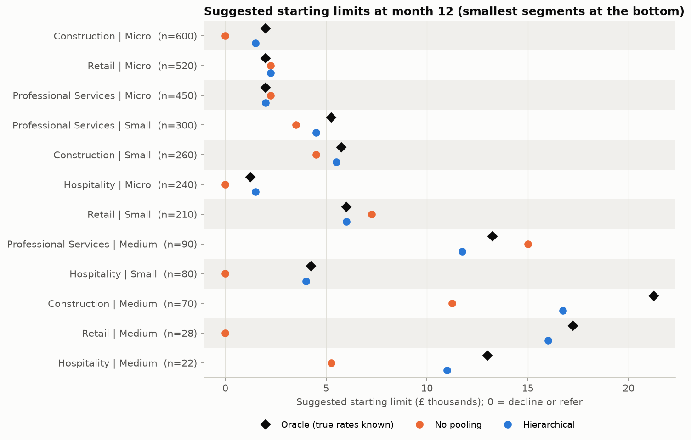
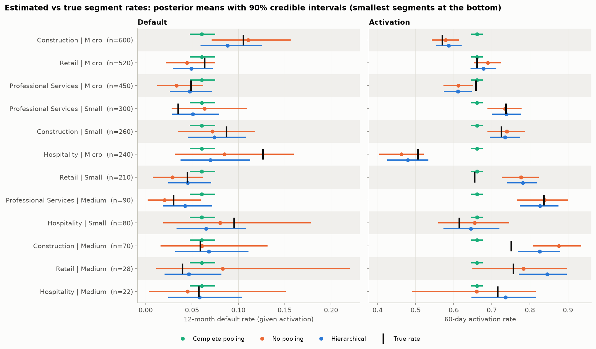
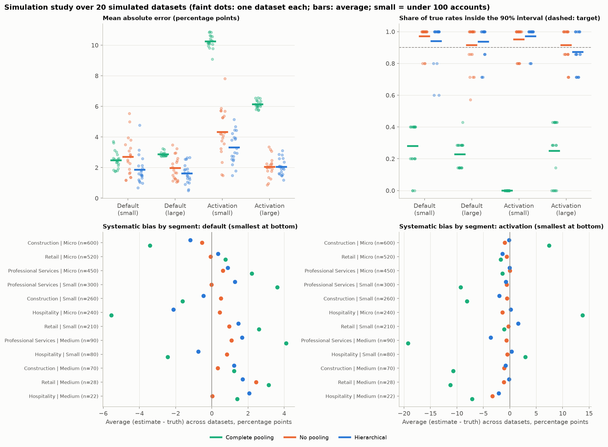
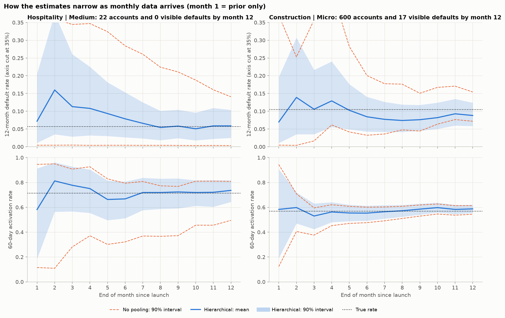
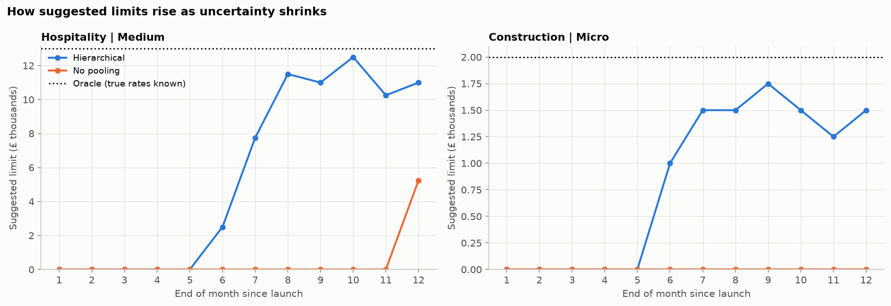
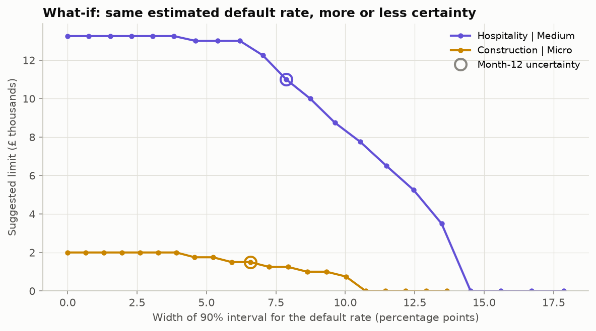

# Bayesian credit limits for a newly launched SME business card

> **All data in this project is simulated.** No real customers, lenders, products or market rates are
> used. The economic assumptions (interchange, interest, loss given default) are illustrative, not
> market data.

## In one minute

**The problem.** A lender has just launched a business credit card. After a year, some customer
segments (for example, medium-sized hospitality businesses) have only a couple of dozen accounts and
almost no defaults. Estimating each segment's default rate from its own data alone gives numbers too
noisy to set credit limits with. Treating every segment the same ignores real differences in risk.

**The approach.** A hierarchical Bayesian model lets small segments borrow strength from similar
segments (same industry, same business size) and from the portfolio as a whole, by an amount the data
decide. It produces a full range of plausible default and activation rates for every segment. The
model is refitted every month as new data arrives, and its estimates are turned into a suggested
starting credit limit that balances expected revenue against expected losses, with a cap on how much
risk the lender will accept.

**The results (on simulated data, where the true answers are known):**

* **Better estimates where it matters.** Across 20 simulated portfolios, the hierarchical model's
  default-rate estimates for small segments were off by 1.9 percentage points on average, against 2.7
  for segment-by-segment estimates. Its uncertainty ranges were about 40% narrower and still contained
  the true rate 94% of the time.
* **Better lending decisions.** Scored against the true economics, the hierarchical model's limits
  earned **£665k** a year across the simulated portfolio, against **£556k** for segment-by-segment
  estimates and **£673k** for an "oracle" that knows the true rates. Segment-by-segment estimates were
  so uncertain that they **declined four segments outright**, including the largest one, turning away
  profitable customers.
* **Limits grow as evidence grows.** Limits start low or "refer" while data are thin and rise as
  uncertainty shrinks month by month.

**The catch.** Sharing information pulls unusual segments towards the average. The riskiest segment's
default rate is under-estimated by about 2 percentage points on average, and it receives a slightly
higher limit than it should. Basing limits on a cautious upper estimate of risk, rather than the
average, limits but does not remove this.



---

## Contents

1. [The business problem](#the-business-problem)
2. [Key results](#key-results)
3. [Limitations](#limitations)
4. [Technical detail](#technical-detail)
5. [How to run it](#how-to-run-it)
6. [Repository structure](#repository-structure)

## The business problem

A new SME business card needs a starting credit limit for each type of customer. Too low, and good
customers put their spending elsewhere; too high, and losses from defaults outweigh the revenue. The
right limit depends on two rates per segment: how likely a business is to **activate** the card
(start using it within 60 days) and how likely it is to **default** within a year.

Early in a product's life these rates are uncertain, and far more so for small segments. Three things
make that worse:

* **Unbalanced segments.** Here the 12 segments (4 industries x 3 size bands) range from 22 to 600
  accounts.
* **Short history.** Customers join month by month, so most have been on book for only a few months.
* **Hidden defaults.** At the 12-month mark, only 55 of the portfolio's 124 eventual first-year
  defaults have actually happened. A naive "defaults divided by accounts" rate badly understates risk.

## Key results

**1. The model finds the true rates, and does so best for small segments.** Estimates with 90%
credible intervals against the true rates, for the three models:



**2. This holds across many datasets, not just one.** Repeating the whole exercise on 20 simulated
portfolios (lower error is better; coverage should be near 90%):

| Default rate, average over 20 datasets | Small segments: error | Small: 90% coverage | Large segments: error | Large: 90% coverage |
|---|---|---|---|---|
| Complete pooling (one rate for all) | 2.5 pp | 28% | 2.9 pp | 23% |
| No pooling (each segment alone) | 2.7 pp | 97% | 2.0 pp | 91% |
| **Hierarchical (partial pooling)** | **1.9 pp** | **94%** | **1.6 pp** | **94%** |

On a fresh hold-out portfolio, the hierarchical model had lower log loss than no pooling for default
in 18 of the 20 datasets.



**3. Uncertainty shrinks as data arrive, fastest with pooling.** At month 12 the smallest segment's
90% interval is 7.9 percentage points wide under the hierarchical model, against 13.7 under no
pooling:



**4. Limits rise as uncertainty shrinks.** Month by month, the hierarchical model starts offering
limits from month 6; no pooling offers the smallest segment nothing until month 12 and never offers the
largest segment anything:



Month-by-month changes mix two effects: the estimate moving and the uncertainty shrinking. Holding a
segment's estimated default rate fixed and varying only the uncertainty isolates the second one:



## Limitations

* **Simulated data from a matching model.** The data were generated with the same structure the
  hierarchical model assumes (industry and size effects on the log-odds scale). Real data would fit
  less neatly, so these results are best-case.
* **Shrinkage bias.** Partial pooling systematically under-estimates the riskiest segments and
  over-estimates the safest (about 2 percentage points at the extremes).
* **Default timing.** The censoring adjustment assumes defaults are spread evenly over the first year,
  which is also how the data were generated. Real defaults tend to cluster a few months in.
* **Thin default data.** The portfolio has 52 usable visible defaults. That pins down the average
  default rate well but says little about how much industries and size bands differ, so those
  "spread" priors still influence the small segments (checked in a prior sensitivity analysis: up to 1
  percentage point).
* **Things left out.** Spend is treated as known; economic conditions, fraud, pricing and competition
  are ignored; limits are not smoothed from month to month.
* **One fixed truth.** The 20-dataset study re-draws accounts but keeps the true segment rates fixed.
  `python src/simulation_study.py --vary-truth` tests other truths; it has not been run here.

---

## Technical detail

### Data generation (`src/data_generation.py`)

Segment rates are set on the log-odds scale:
`logit(rate) = intercept + industry effect + size effect + segment noise (sd 0.15)`.
True default rates (given activation) range from 3.0% to 12.7%; activation rates from 51% to 84%.
Accounts arrive in 12 monthly cohorts that grow as the product ramps up. Each account activates
within 60 days with its segment's activation rate; only activated accounts can default; default month
is uniform on 1..12; the snapshot at month 12 shows only defaults that have happened. Spend is
lognormal by size band and industry, and utilisation is higher for future defaulters. All true
parameters are saved to `data/true_parameters.json`, and the hidden outcomes to a separate
`data/accounts_truth.csv` that no model reads.

### Model (`src/priors.py`, `src/model.py`)

For each outcome (default and activation), each segment *s* in industry *i* and size band *j*:

```
logit(rate_s) = mu + sigma_industry * a_i + sigma_size * b_j + sigma_segment * e_s
a, b, e ~ Normal(0, 1)                                  (non-centred parameterisation)

activated_s     ~ Binomial(accounts with a closed 60-day window, activation_rate_s)
defaults_{s,m}  ~ Binomial(activated accounts with m months on book, default_rate_s * m / 12)
```

| Prior | Default | Activation | Reasoning |
|---|---|---|---|
| mu | Normal(logit 5%, 0.75) | Normal(logit 60%, 1.0) | Portfolio rate 95% likely in 1.2-19% (default) or 17-91% (activation) |
| sigma_industry, sigma_size | HalfNormal(0.4) | HalfNormal(0.4) | Together with sigma_segment, matches the spread of a single HalfNormal(0.5) |
| sigma_segment | HalfNormal(0.25) | HalfNormal(0.25) | Leftover segment-specific variation, expected to be smaller |

Prior predictive checks put 95% of implied segment default rates in 0-20% (a Normal(0, 10) "vague"
prior puts 45% there and piles the rest up near 0% and 100%).

**Baselines:** complete pooling (one rate, same prior as mu) and no pooling (independent
Normal(logit 5%, 1.5) per segment), so the models differ only in how much they share.

**Sampling:** PyMC NUTS, 4 chains x 1,000 draws after 1,000 tuning steps, `target_accept=0.95`. All
three models: max R-hat 1.005, minimum bulk ESS 1,636 and tail ESS 1,268 (hierarchical), no
divergences. The 24 monthly refits in Stage 5 use the nutpie sampler (the same NUTS algorithm in Rust,
much less per-step overhead) with 2,000 draws; max R-hat 1.005, minimum ESS 944, no divergences.

### Statistical choices and the alternatives considered

| Choice | Chosen | Alternatives | Why |
|---|---|---|---|
| Censoring | Exposure adjustment (`rate x m/12`) | Monthly hazard model; mature accounts only | Uses every account; mature-only leaves ~120 accounts |
| Hierarchy | Crossed industry + size + segment | 12 exchangeable segments | Small segments borrow from both their industry and their size band |
| No-pooling baseline | Bayesian, independent wide priors | Maximum likelihood proportions | Gives comparable credible intervals; MLE gives exactly 0% for zero-default segments |
| Monthly updating | Refit on all data to date | Previous posterior as next prior | Ageing accounts are seen again each month; re-using the posterior would double-count them |
| Risk threshold | P(expected loss > 50% of revenue) < 5% | Fixed £ per account; loss-rate gate | Scales with business size and lets uncertainty move the limit |
| Month-12 cohort | Left out of both models | Keep its visible defaults | Keeping only its defaulters would bias default rates upwards |

### Validation (`src/validate.py`, `src/simulation_study.py`)

* **Parameter recovery** against the known true rates for all three models, plus a test that fits a
  fresh dataset and requires at least 9 of 12 true rates inside the 90% intervals (criteria fixed
  before the test was first run).
* **Posterior predictive checks:** complete pooling cannot reproduce the observed spread of segment
  activation rates (p = 0.001); the hierarchical model reproduces every statistic checked and every
  segment's counts.
* **Hold-out calibration** on a fresh portfolio three times the size, with a full year of history.
* **Prior sensitivity:** moving the default prior's centre between 2% and 10% shifts any segment by at
  most 0.4 percentage points; halving or doubling the spread priors shifts segments by up to 1.0.
* **Multi-seed study:** 20 datasets x 3 models; results above. In this run 7 of the 60 fits had 1-4
  divergences out of 4,000 draws (which model was not recorded).

The main dataset (seed 7) turned out to be unlucky in places: one segment's observed activation rate is
3.5 standard deviations from its true value, and the first cohort had 4 early defaults where about 1
was expected. Both were checked against 200 and 50 other seeds, which showed the generator is
unbiased. The seed was kept, as changing it after seeing results would be cherry-picking.

### Credit limit rule (`src/decision.py`)

Per activated account over one year, with monthly spend need S ~ lognormal (estimated per segment):

```
card spend   = E[min(S, L)]
revenue      = card spend x (12 x interchange + (APR - funding cost) x share revolved)
loss         = PD x LGD x exposure share at default x L
profit       = P(activate) x (revenue - loss) - fixed cost

choose L maximising mean profit over posterior draws,
subject to P(loss > 50% of revenue) < 5% over posterior draws
```

| Assumption | Value |
|---|---|
| Interchange | 1.5% of card spend |
| APR / funding cost | 24% / 5% |
| Revolving balance | 30% of monthly card spend |
| Loss given default | 85% |
| Exposure at default | 90% of the limit |
| Fixed cost per approved account | £50 a year |

The limit is chosen on a £250 grid from £250 to £50,000; 0 means "decline or refer". The "oracle" uses
the true rates with the same spend estimates and risk rule, so it is a benchmark rather than an upper
bound.

## How to run it

Tested with Python 3.13 on Windows. PyMC 6 and ArviZ 1 have different APIs from earlier versions, so
the version bounds in `requirements.txt` matter.

```bash
python -m venv .venv
.venv/Scripts/activate            # macOS/Linux: source .venv/bin/activate
pip install -r requirements.txt
python run_all.py                 # all six stages, about 7 minutes
pytest                            # 24 tests, about 1 minute
```

The walkthrough notebook `notebooks/walkthrough.ipynb` runs the same stages with commentary. The
optional multi-seed study takes about 25 minutes: `python src/simulation_study.py --seeds 20`.

If PyMC fails while compiling with a path containing `;`, your Python was probably built from source;
a standard Python (python.org or Anaconda) avoids it.

## Repository structure

```
data/                  simulated portfolio and the true parameters
figures/               every figure in this README and the notebook
notebooks/             walkthrough.ipynb: the whole project with commentary
reports/               result tables (CSV) behind the figures and numbers
src/
  data_generation.py   Stage 1: simulator with known true parameters
  priors.py            Stage 2: priors
  prior_checks.py      Stage 2: prior predictive checks
  model.py             Stage 3: the three models and diagnostics
  fit_models.py        Stage 3: fit and check convergence
  validate.py          Stage 4: recovery, posterior predictive, calibration, sensitivity
  simulation_study.py  Stage 4 (optional): 20-dataset study
  sequential.py        Stage 5: month-by-month refits
  decision.py          Stage 6: credit limits
  plotting.py          shared figure style
tests/                 generator, priors, models, parameter recovery, sequential, decision
run_all.py             runs Stages 1-6
```
